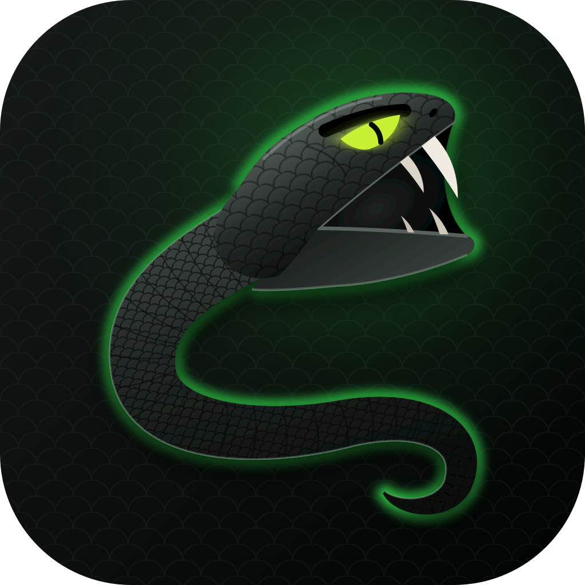
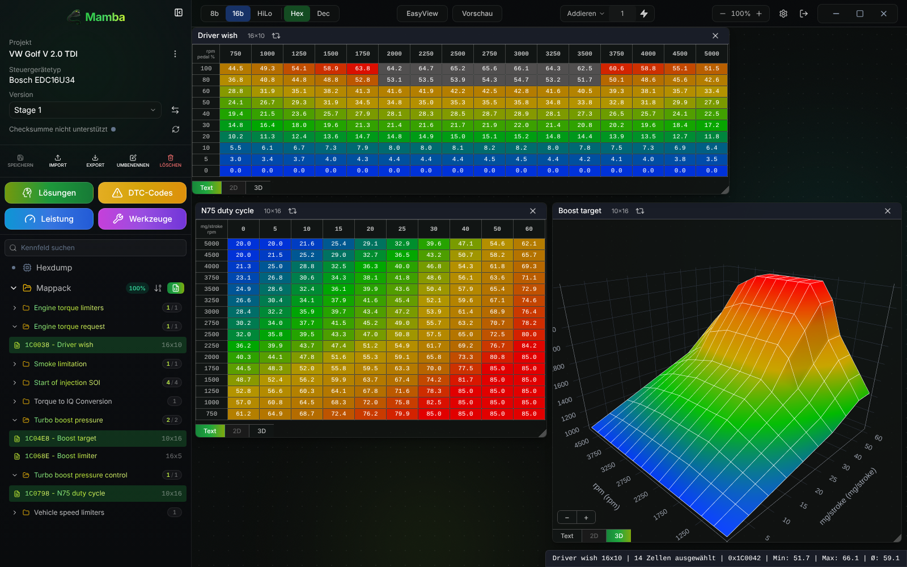
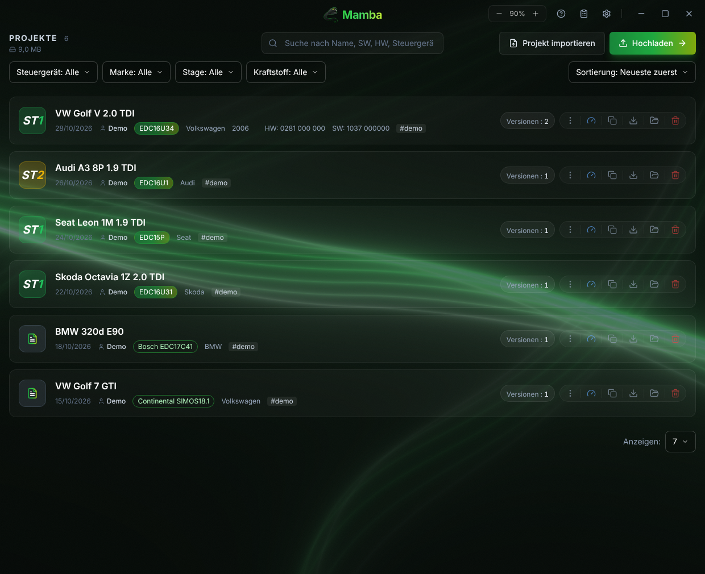
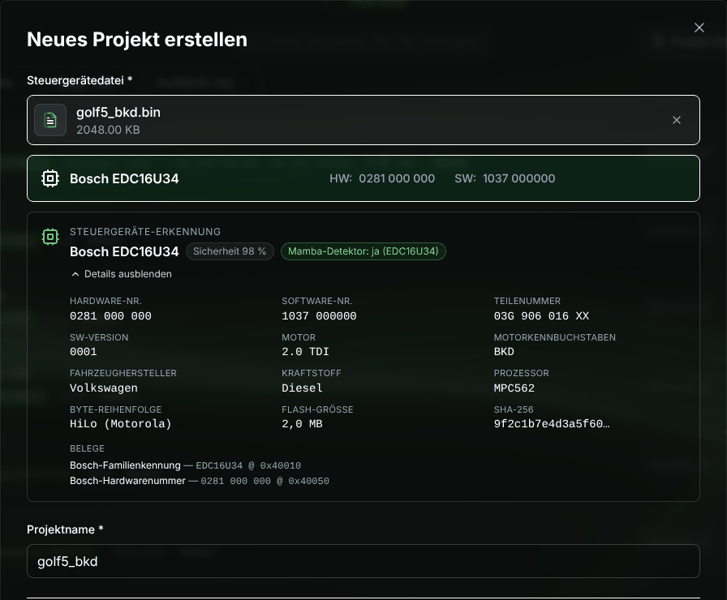
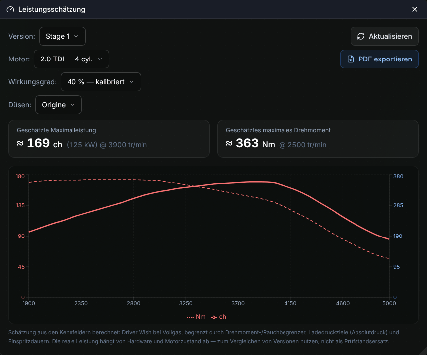

<p align="center">
  
</p>

<h1 align="center">Mamba</h1>

<p align="center">
  <b>Open-Source-Tuning-Editor für Steuergeräte-Binaries</b><br>
  100 % lokal · Windows, macOS und Linux · kein Konto, keine Cloud
</p>

<p align="center">
  <a href="https://github.com/bobnautic/Mamba/releases"></a>
  
  
  <a href="LICENSE"></a>
</p>

<p align="center">
  <a href="docs/benutzung.md"><b>Benutzung</b></a> ·
  <a href="https://github.com/bobnautic/Mamba/releases">Download</a> ·
  <a href="ROADMAP.de.md">Roadmap</a> ·
  <a href="docs/entwicklung.md">Entwicklung</a> ·
  <a href="CONTRIBUTING.md">Mitmachen</a>
</p>



Mamba öffnet den Flash-Dump eines Motorsteuergeräts, erkennt Steuergerät und Kennfelder und lässt dich die Kennfelder als Tabelle, 2D-Kurve, 3D-Fläche oder im Hexdump bearbeiten. Deine Dateien verlassen den Rechner nie.

## Funktionen

- **Automatische Kennfelderkennung** für Bosch EDC15 und EDC16 (Rust-Engine)
- **ECU-Erkennung für jedes Binary**: Hersteller, Familie, HW-/SW-Nummern, Motor, Byte-Reihenfolge
- **Eigene Definitionen (Beta)**: jedes andere Steuergerät mit WinOLS-`.ols`, TunerPro-`.xdf` oder JSON-Mappack
- **Editor**: Tabelle, 2D, 3D, Hexdump, Kopieren und Einfügen auch mit Excel
- **Versionen**: Original plus beliebig viele Stände, mit Byte-Vergleich
- **Werkzeuge**: DTC an/aus, Prüfsummenkorrektur (EDC15/16), Leistungsschätzung mit PDF-Bericht
- **Projektbibliothek**: Suche, Filter, Duplikaterkennung, Export als `.mamba`-Archiv
- **3 Themes, 7 Sprachen, automatische Updates**

<table>
  <tr>
    <td width="33%"></td>
    <td width="33%"></td>
    <td width="33%"></td>
  </tr>
  <tr>
    <td align="center"><sub>Projektbibliothek</sub></td>
    <td align="center"><sub>ECU-Erkennung beim Anlegen</sub></td>
    <td align="center"><sub>Leistungsschätzung</sub></td>
  </tr>
</table>

<sub>Screenshots mit synthetischen Demo-Daten.</sub>

## Unterstützte Steuergeräte

- **Automatische Kennfelderkennung:** Bosch EDC15P, EDC15VM+, EDC16U1, EDC16U31, EDC16U34
- **Jedes andere Binary:** öffnet sich mit eigenen Definitionen (`.ols`, `.xdf`, JSON-Mappack); das Steuergerät wird trotzdem erkannt

Weitere Familien folgen, siehe [Roadmap](ROADMAP.de.md).

## Download

Installer gibt es unter **[Releases](https://github.com/bobnautic/Mamba/releases/latest)**, jede Version mit eigenen Dateien und `SHA256SUMS.txt`:

| System | Datei |
|---|---|
| Windows 10/11 | `Mamba_x.y.z_x64-setup.exe` |
| macOS 12+ (Apple Silicon und Intel) | `Mamba_x.y.z_macos-universal.dmg` |
| Linux | `Mamba_x.y.z_linux-x86_64.AppImage` oder `.deb` |

Ältere Versionen bleiben unter [allen Releases](https://github.com/bobnautic/Mamba/releases) verfügbar. Windows zeigt beim ersten Start eine SmartScreen-Warnung, weil der Installer nicht signiert ist: *Weitere Informationen › Trotzdem ausführen*.

Die macOS-Version ist nicht signiert. Erlaube sie beim ersten Start unter *Systemeinstellungen › Datenschutz & Sicherheit › Trotzdem öffnen*, oder installiere per Terminal:

```bash
curl -fsSL https://raw.githubusercontent.com/bobnautic/Mamba/main/install-macos.sh | sh
```

Wie es danach weitergeht, steht in der **[Benutzung](docs/benutzung.md)**.

## Entwicklung

```bash
npm install
npm run app:dev     # Desktop-App mit Hot Reload
npm run app:build   # Installer unter src-tauri/target/release/bundle/
```

Voraussetzungen, Architektur und Tests stehen in [docs/entwicklung.md](docs/entwicklung.md). Beiträge sind willkommen, neue Steuergerätefamilien zuerst, nach den Regeln in [CONTRIBUTING.md](CONTRIBUTING.md).

## Danksagung

Alle, die am Code mitgewirkt haben, stehen in [CONTRIBUTORS.md](CONTRIBUTORS.md). Dank an **Dilemma** für [VAGEDCSuite](https://github.com/Blackfrosch/VAGEDCSuite) und **Skalda** für die [Weiterentwicklung](https://github.com/skaldamramra/VAGEDCSuite).

## Lizenz und Haftung

[GPL-3.0](LICENSE). Hinweise in [NOTICE](NOTICE).

Mamba ist für Forschung, Ausbildung sowie Motorsport- und Offroad-Einsatz gedacht. Änderungen am Steuergerät eines Straßenfahrzeugs können illegal sein, Garantie und Betriebserlaubnis erlöschen lassen und den Motor beschädigen. Du allein bist verantwortlich. Abgasrelevante Abschaltungen (AGR, DPF, SCR) sind nicht Teil des Projekts.

**Sicherheit:** Lade Mamba nur aus den [offiziellen Releases](https://github.com/bobnautic/Mamba/releases) herunter.
