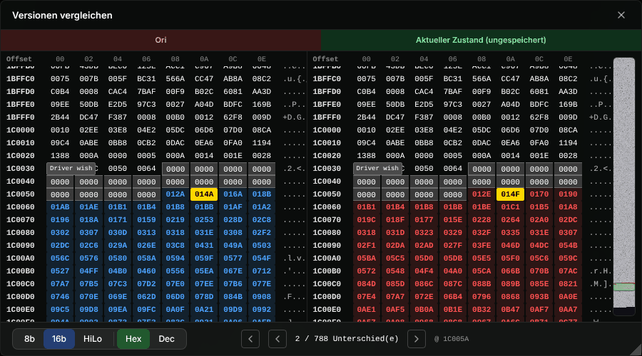
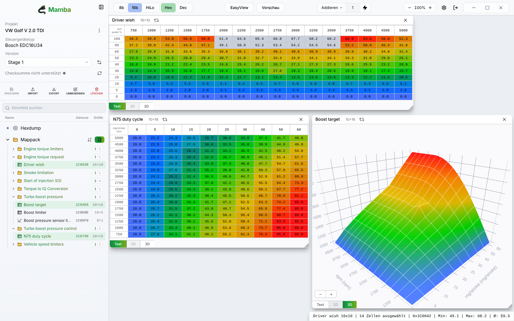

# Mamba benutzen

Diese Anleitung führt durch die App, vom ersten Start bis zum Export der fertigen Datei. Installation und Download stehen im [README](../README.md#download).

Alle Screenshots zeigen synthetische Demo-Daten, keine echten Steuergeräte-Dumps.

**Inhalt**

1. [Erster Start](#1-erster-start)
2. [Projektbibliothek](#2-projektbibliothek)
3. [Neues Projekt anlegen](#3-neues-projekt-anlegen)
4. [Der Editor](#4-der-editor)
5. [Kennfelder bearbeiten](#5-kennfelder-bearbeiten)
6. [Versionen](#6-versionen)
7. [Leistungsschätzung](#7-leistungsschätzung)
8. [Exportieren](#8-exportieren)
9. [Steuergeräte ohne Mamba-Detektor](#9-steuergeräte-ohne-mamba-detektor)
10. [Einstellungen](#10-einstellungen)
11. [Daten und Sicherung](#11-daten-und-sicherung)
12. [Häufige Fragen](#12-häufige-fragen)

---

## 1. Erster Start

Beim ersten Start erscheint **„Willkommen bei Mamba“**:

- **Name des Tuners**: optional, erscheint auf exportierten PDF-Berichten
- **Sprache**: Deutsch, Englisch, Französisch, Spanisch, Italienisch, Portugiesisch oder Rumänisch
- **Design**: Standard (Black Mamba), Hell oder OLED

Mit **„Los geht's“** landest du in der Projektbibliothek. Alles lässt sich später unter *Einstellungen* ändern.

## 2. Projektbibliothek

Jede Zeile ist ein Projekt: ein Original-Binary mit seinen Versionen und Fahrzeugdaten. Ein Klick auf die Zeile öffnet den Editor.

**Suchen und Filtern**

- Die Suche durchsucht alle Felder: Name, SW-/HW-Nummern, Steuergerät, FIN, Kennzeichen, Tags und alle im Binary erkannten Nummern.
- Filter: **Steuergerät**, **Marke**, **Stage**, **Kraftstoff**. Ein Filter erscheint erst, wenn es Werte dafür gibt.
- **Sortierung**: Neueste zuerst, Älteste zuerst, Zuletzt geändert, Name (A–Z), Steuergerät.
- **Anzeigen**: Projekte pro Seite (7 bis 100).

**Aktionen pro Projekt** (Symbole rechts, von links nach rechts):

| Symbol | Aktion |
|---|---|
| ⋮ | **Projektinformationen**: Fahrzeugdaten, Kunde, Stage, FIN, Kennzeichen, Tags, Notizen; zeigt die ECU-Erkennung |
| Tacho | **Leistungsschätzung** (siehe [Leistungsschätzung](#7-leistungsschätzung)) |
| Kopie | **Projekt duplizieren**: Kopie mit allen Versionen |
| Download | **Projekt exportieren (.mamba)**: Original, alle Versionen und Kennfeldänderungen in einer Datei |
| Ordner | **Projektordner öffnen** im Dateimanager |
| Papierkorb | **Löschen** (mit Rückfrage, nicht umkehrbar) |

Projekte mit identischem Original-Binary (gleicher SHA-256) tragen das Abzeichen **„Gleiche Datei“**.

Oben rechts:

- **Projekt importieren** lädt ein `.mamba`-Archiv.
- **Hochladen** legt ein neues Projekt an.

## 3. Neues Projekt anlegen

1. Klicke auf **Hochladen** und dann auf **„Zum Hochladen klicken“**. Wähle den Flash-Dump (`.bin` o. Ä.) oder ein WinOLS-Projekt (`.ols`), maximal 42 MB. Mamba erkennt das Format am Inhalt, nicht an der Endung.
2. Mamba analysiert die Datei sofort und zeigt die **Steuergeräte-Erkennung**: Hersteller und Familie, Hardware-, Software- und Teilenummer, Motor, Prozessor, Byte-Reihenfolge, Flash-Größe, SHA-256 und die Fundstellen im Binary. Das Abzeichen **„Mamba-Detektor: ja“** bedeutet, dass die Kennfelder automatisch gefunden werden.
3. Marke, Motor und Kraftstoff werden vorausgefüllt. Ergänze Projektname und die übrigen Fahrzeugdaten. Bis auf den Projektnamen ist alles optional.
4. Klicke auf **„Projekt erstellen & Kennfelder erkennen“**. Der Editor öffnet sich.

**Sonderfälle**

- **Datei schon in der Bibliothek**: Mamba meldet es und bietet **„Vorhandenes Projekt öffnen“** an. Du kannst trotzdem ein zweites Projekt anlegen.
- **WinOLS-Projekt mit mehreren Versionen**: Wähle die Version, die als Original dient. Optional werden die anderen gleich als Projektversionen übernommen.
- **Steuergerät ohne Mamba-Detektor**: siehe [Abschnitt 9](#9-steuergeräte-ohne-mamba-detektor).

> **Tipp für stark modifizierte Dateien:** Die Erkennung arbeitet auf der Struktur, nicht auf den Daten. Getunte Dateien werden fast immer erkannt. Wenn nicht: Lege das Projekt aus der **Originaldatei** an und importiere die modifizierte Datei als **neue Version** ([Abschnitt 6](#6-versionen)).

## 4. Der Editor

**Seitenleiste (links)**

- **Projekt**, **Steuergerätetyp** und **Version** mit Versionsauswahl und **⇄ Vergleichen**
- **Checksumme**: OK, ungültig oder nicht unterstützt. Der Pfeil berechnet sie neu (EDC15/EDC16).
- **SPEICHERN · IMPORT · EXPORT · UMBENENNEN · LÖSCHEN**: Versionen speichern und verwalten, siehe [Versionen](#6-versionen) und [Exportieren](#8-exportieren)
- **Kennfeldbaum**, aufgebaut wie die Kennfeldliste von WinOLS:
  - **Kennfeld suchen** findet Kennfelder nach Name oder Adresse. Suche und Spaltenköpfe (**Name · Adresse · Größe**) bleiben beim Scrollen oben stehen.
  - **Hexdump** öffnet die Rohdaten.
  - Unter **Mappack** sind die Kennfelder in Ordnern nach Kategorie gruppiert. Eine gepunktete Linie verbindet jeden Ordner mit seinen Einträgen, die Zahl rechts am Ordner zeigt geänderte / alle Kennfelder.
  - Jede Zeile zeigt Name, Adresse (hex) und Größe (Spalten × Zeilen). Das Symbol davor nennt den Typ: Tabelle = **Kennfeld**, Kurve = **Kennlinie**, einzelne Zelle = **Einzelwert**. Geänderte Kennfelder sind grün.
  - Das %-Abzeichen am Mappack ist die **Vollständigkeitsprüfung**: Es zeigt, wie viele der für diese Familie erwarteten Kennfelder gefunden wurden. Ein Klick öffnet den **Mappack-Status** mit den fehlenden Kennfeldern.
  - Daneben schaltet ein Knopf die Sortierung um (Adresse, A→Z, Z→A), und **Export** speichert das Mappack.

**Arbeitsfläche**

- Jedes Kennfeld öffnet sich in einem eigenen Fenster. Ziehe es an der Titelleiste und ändere die Größe an der unteren rechten Ecke.
- Unten im Fenster wechselst du die Ansicht: **Text** (Tabelle), **2D** (nur einzeilige Kennfelder) und **3D**.
- Das Pfeilsymbol neben dem Titel (**„Ansicht umkehren“**) tauscht Zeilen und Spalten.

**Werkzeugleiste (oben)**

- **8b / 16b**, **LoHi / HiLo**, **Hex / Dec**: Darstellung des Hexdumps
- **EasyView**: Tabelle und 3D nebeneinander
- **Vorschau**: zeigt das zuletzt angeklickte Kennfeld zusätzlich in 3D
- **Addieren / Füllen / Prozent**, Wertfeld und ⚡: Rechenoperation auf die Auswahl anwenden (siehe unten)
- Zoom, Einstellungen und **Projekt schließen**

Die **Statusleiste** unten rechts zeigt das aktive Kennfeld, die Adresse und für eine Auswahl Anzahl, Minimum, Maximum und Mittelwert.

## 5. Kennfelder bearbeiten

**Auswählen**

- Klick wählt eine Zelle. Ziehen wählt ein Rechteck; reicht es in die Achsen, werden die Achswerte mit ausgewählt.
- **Strg/⌘ + Klick** oder **Strg/⌘ + Ziehen** erweitert die Auswahl.
- Pfeiltasten bewegen die Zelle, **Strg/⌘ + Pfeil** erweitert die Auswahl.

**Werte ändern**

- **Doppelklick** auf eine Zelle oder einen Achswert öffnet ein Eingabefeld für den neuen Wert.
- **Werkzeugleiste**: Wähle **Addieren**, **Füllen** oder **Prozent**, gib den Wert ein und klicke auf ⚡ (oder drücke Enter).
- Die Tasten **+** und **−** erhöhen bzw. verringern die Auswahl um den Wert aus der Werkzeugleiste. Im Modus *Prozent* geschieht das prozentual; im Modus *Füllen* bewirken die Tasten nichts.
- Werte werden auf den gültigen Bereich des Kennfelds begrenzt.

Geänderte Werte folgen der WinOLS-Konvention: **rot** = über dem Original, **blau** = darunter.

**Kontextmenü (Rechtsklick)**

| Eintrag | Wirkung |
|---|---|
| Kopieren / Mit Achsen kopieren | Auswahl als Tabelle in die Zwischenablage (auch für Excel) |
| Einfügen | Block aus der Zwischenablage einfügen, auch aus Excel, auch mit Achsen |
| Auswahl glätten | Übergänge in der Auswahl glätten |
| Erhöhen / Verringern | um den Wert aus der Werkzeugleiste |
| Absolut ändern | alle gewählten Zellen auf einen festen Wert setzen |
| Originalwert | Auswahl auf den Wert der Originaldatei zurücksetzen |
| Ähnliche Kennfelder ändern | dieselbe Änderung auf gleichnamige Kennfelder gleicher Größe übertragen, wahlweise nur die Änderungen oder das ganze Kennfeld |
| Eigenschaften | Startadresse, Faktor, Offset, Einheit, Spiegeln der Achsen usw. für Kennfeld, X- und Y-Achse |
| Im Hexdump anzeigen | (nur 3D) springt zur Adresse im Hexdump |

**Tastenkürzel**

| Taste | Wirkung |
|---|---|
| ← ↑ → ↓ | aktive Zelle bewegen |
| Strg/⌘ + Pfeil | Auswahl erweitern |
| Strg/⌘ + A | ganzes Kennfeld mit Achsen auswählen |
| Strg/⌘ + C | kopieren |
| Strg/⌘ + V | einfügen |
| + / − | Auswahl erhöhen / verringern |
| Enter / Esc | Eingabe bestätigen / abbrechen |

**Hexdump**

- Der Hexdump ist zum Ansehen und Navigieren da. Er hat eine Minimap mit markierten Änderungen gegenüber dem Original.
- Ein Klick auf einen Kennfeldbereich öffnet das Kennfeld.
- Mit **Suchen** findest du Werte, optional in einem Adressbereich oder in der Originaldatei.

## 6. Versionen

Jedes Projekt beginnt mit der Version **Ori**: die Originaldatei, die nie verändert wird.

- **SPEICHERN** auf *Ori* legt eine neue Version an und fragt nach dem Namen, z. B. „Stage 1“. Auf jeder anderen Version speichert der Knopf die Änderungen in diese Version.
- **+ Neue Version (Speichern unter)** im Versionsmenü legt aus dem aktuellen Stand eine neue Version an.
- **UMBENENNEN** und **LÖSCHEN** gelten für die aktuelle Version. *Ori* lässt sich weder umbenennen noch löschen.
- **IMPORT** übernimmt eine extern bearbeitete Datei als neue Version. Sie muss zum Projekt passen: gleiche Größe und gleiches Steuergerät bzw. gleiche HW/SW, oder mindestens 90 % identisch. Sonst lehnt Mamba sie mit Begründung ab. Alle Versionen teilen sich die Kennfeldliste des Originals.
- Wechselst du die Version oder schließt das Projekt mit ungespeicherten Änderungen, fragt Mamba nach: **Verwerfen** oder **Speichern**.

**Versionen vergleichen**

Klicke in der Seitenleiste auf **⇄**, wähle **Links** und **Rechts** (auch „Aktueller Zustand (ungespeichert)“) und dann **Vergleichen**.

- Mamba vergleicht die beiden Binaries Byte für Byte.
- Mit **←** / **→** springst du von Unterschied zu Unterschied.
- Gehört eine Stelle zu einem Kennfeld, steht dessen Name an der Stelle.

## 7. Leistungsschätzung

- Das Tacho-Symbol in der Bibliothek schätzt Leistung und Drehmoment aus den Kennfeldern der gewählten Version: Fahrerwunsch bei Vollgas, begrenzt durch Drehmoment- und Rauchbegrenzer, Ladedruck und Einspritzdauer.
- Einstellbar sind **Motor**, **Wirkungsgrad** und **Düsen**. Codeblöcke (EDC15) bzw. Fahrerwunsch-Kennfelder (EDC16) lassen sich als eigene Kurven ein- und ausblenden.
- **PDF exportieren** erzeugt einen Bericht mit Kurve, wahlweise dunkel oder hell. Firmenname und Logo kommen aus den Einstellungen.

Die Schätzung dient zum **Vergleichen von Versionen** und ersetzt keinen Prüfstand.

## 8. Exportieren

| Was | Wo | Ergebnis |
|---|---|---|
| Modifiziertes Binary | **EXPORT** in der Seitenleiste | `.bin` der aktuellen Version, bei EDC15/EDC16 vorher mit Prüfsummenprüfung |
| Mappack | **Export** am Mappack im Kennfeldbaum | WinOLS-kompatibles JSON-Mappack |
| Ganzes Projekt | Download-Symbol in der Bibliothek | `.mamba`-Archiv mit Original, Versionen und Änderungen |
| Leistungsbericht | **PDF exportieren** in der Leistungsschätzung | PDF |

**Prüfsumme beim Export (EDC15/EDC16)**

- Ist die Prüfsumme in Ordnung, steht dort **„Checksumme OK — bereit zum Export“**.
- Ist sie fehlerhaft, wählst du **Vor dem Export korrigieren** oder **Ohne Korrektur exportieren**.
- Bei anderen Steuergeräten wird ohne Prüfsummenkorrektur gespeichert. Die Prüfsumme musst du dann selbst korrigieren, z. B. mit deinem Flash-Tool.

## 9. Steuergeräte ohne Mamba-Detektor

Jedes Binary lässt sich öffnen, auch wenn Mamba die Kennfelder dafür noch nicht selbst findet (**Beta**):

1. Lege das Projekt wie gewohnt an. Die ECU-Erkennung zeigt trotzdem Hersteller, Familie und Nummern, z. B. „Bosch EDC17C46“, und den Hinweis *„noch kein Mamba-Kennfelddetektor“*.
2. Im Editor importierst du die Kennfelddefinitionen über **Kennfeld-Definitionen importieren** im Kennfeldbaum oder über **IMPORT**:
   - **TunerPro `.xdf`**
   - **JSON-Mappack**
   - Ein **WinOLS-`.ols`**-Projekt bringt seine Kennfelder beim Anlegen schon mit.
3. Die importierten Kennfelder erscheinen in einem eigenen Ordner und lassen sich wie alle anderen bearbeiten und exportieren.

Bei solchen Projekten sind Leistungsschätzung und Prüfsummenkorrektur nicht verfügbar. Fehler beim Lesen einer Datei bitte als [Issue](https://github.com/bobnautic/Mamba/issues) melden, mit Datei wenn möglich.

## 10. Einstellungen

**Einstellungen** (Zahnrad in der Bibliothek)

- **Design**: Standard, Hell, OLED
- **Dashboard-Hintergrund**: automatisch, animierte Linien, Weiß, Schwarz oder ein eigenes Bild
- **Sprache**, **Firmenname** und **Logo des Prüfstandsblatts** (beide für PDF-Berichte)
- **Updates**: Mamba sucht einmal täglich nach Updates. **Nach Updates suchen** prüft sofort, die Installation ist ein Klick.

**Editor-Einstellungen** (Zahnrad in der Werkzeugleiste)

- Design und Hintergrund des Editors
- **EasyView als Standard**; Tabellen- und 3D-Farben abschalten
- **Map-Darstellung pro Steuergerät merken**: Inversion, Spiegelung und Faktoren gelten dann auch für andere Projekte mit demselben Steuergerät
- **Automatisches Speichern** mit Intervall (2, 5, 15 oder 30 Minuten)

## 11. Daten und Sicherung

Alles liegt lokal, ein Ordner pro Projekt mit Original-Binary, Metadaten und Versionen:

| System | Ordner |
|---|---|
| Windows | `%APPDATA%\com.bobnautic.mamba\projects\` |
| macOS | `~/Library/Application Support/com.bobnautic.mamba/projects/` |
| Linux | `~/.local/share/com.bobnautic.mamba/projects/` |

Zum Sichern oder Weitergeben eines einzelnen Projekts nimmst du am besten den **`.mamba`-Export**. Ein Archiv lässt sich beliebig oft importieren; jede Kopie wird ein eigenes Projekt.

## 12. Häufige Fragen

**„Checksumme nicht unterstützt“, was heißt das?**
Mamba korrigiert Prüfsummen für EDC15 und EDC16. Bei anderen Familien oder unbekannten Layouts musst du die Prüfsumme selbst korrigieren lassen, z. B. vom Flash-Tool.

**Ein Kennfeld fehlt in der Liste.**
Klicke auf das %-Abzeichen am Mappack. Der **Mappack-Status** zeigt, welche erwarteten Kennfelder fehlen. Bei stark modifizierten Dateien hilft der [Tipp aus Abschnitt 3](#3-neues-projekt-anlegen). Sonst bitte ein [Issue](https://github.com/bobnautic/Mamba/issues) mit Steuergerätetyp und Softwarenummer.

**Mein Import wird mit „Datei abgelehnt“ quittiert.**
Die Datei passt nicht zum Projekt: andere Größe, anderes Steuergerät oder zu viele Unterschiede. Lege dafür ein eigenes Projekt an.

**Lässt sich eine Änderung rückgängig machen?**
Es gibt kein Strg+Z. Markiere die Zellen und wähle im Kontextmenü **Originalwert**, oder wechsle ohne Speichern die Version und wähle **Verwerfen**.

**macOS meldet, die App sei beschädigt oder nicht vertrauenswürdig.**
Die App ist nicht signiert. Siehe [Download](../README.md#download).
